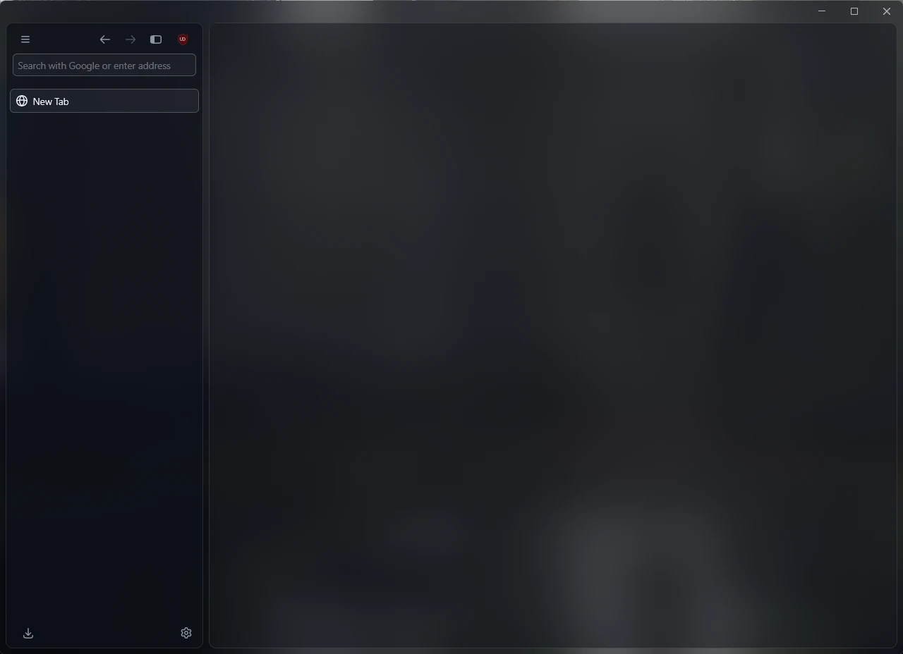
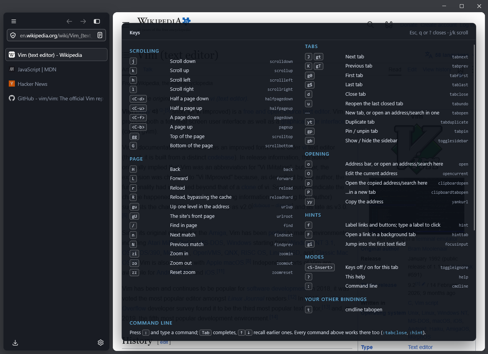
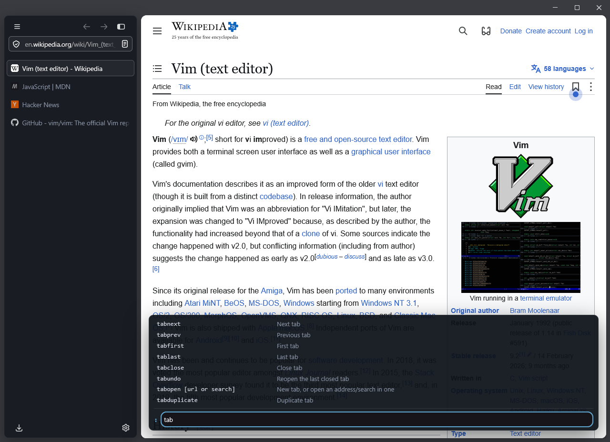

# vimfox

**A keyboard-driven Firefox with Vim keys built in — on every page, including
the ones extensions can't touch.**

vimfox is a Firefox *profile*, not a fork and not an extension: a set of
settings, styles and scripts that turn regular Firefox into a dark,
see-through, vertical-tab browser you drive with Vim keys. Nothing to
compile, and Firefox keeps updating itself as usual.



- **Vim keys on every page.** Websites, the new tab page, Settings,
  about:addons and addons.mozilla.org — places Tridactyl or Vimium can't run.
  Keys are read before the page sees them, so sites can't take them over.
- **Link hints, a command line and a help panel**, Tridactyl-style.
- **One plain-text config file**, reloaded the moment you save it.
- **A tidy toolbar:** add-ons live in the puzzle-piece tray — new ones go
  there instead of onto the toolbar (right-click → *Pin to Toolbar* to keep
  one out).
- **A calm, translucent look:** the sidebar and the page float as two cards
  over a Windows acrylic (blurred) backdrop; menus, settings pages and
  addons.mozilla.org are see-through too.

Built and tested on Firefox 160 on Windows 11.

## Quick start

You need [Node.js](https://nodejs.org) 18+ and Firefox.

```
git clone git@github.com:kalix123/vimfox.git
cd vimfox
```

**1. Once, from an administrator terminal** (Windows: right-click PowerShell →
*Run as administrator*):

```
node scripts/install.mjs --install-loader
```

This puts a tiny loader into the Firefox install folder so a profile can run
its own scripts. Profiles that aren't vimfox are unaffected, an existing
`config.js` there is kept as `config.js.bak`, and it never needs re-running.

**2. Install and start:**

```
node scripts/install.mjs --launch
```

This creates (or updates) a separate Firefox profile called `vimfox` and
starts Firefox on it. Your other profiles are left alone. Press `?` on any
page to see the keys.

To update later: `git pull` and run step 2 again. Your key config is never
overwritten.

**Starting it without a terminal:** open `about:profiles` and click **Set as
default profile** under `vimfox` — the normal Firefox icon then opens it. Or
keep your default and make a shortcut to
`"C:\Program Files\Mozilla Firefox\firefox.exe" -P vimfox`.

## Keys

`?` on any page shows every key, including the ones you've added:



| Keys | Does |
| --- | --- |
| `j` `k` `h` `l` | scroll down / up / left / right |
| `<C-d>` `<C-u>` · `<C-f>` `<C-b>` | half page · full page down / up |
| `gg` `G` | top / bottom |
| `H` `L` | back / forward |
| `r` `R` | reload / reload bypassing the cache |
| `gu` `gU` | up one level in the address / site root |
| `J` `K` (or `gt` `gT`) | next / previous tab |
| `g0` `g$` | first / last tab |
| `d` `u` | close tab / reopen closed tab |
| `t` | new tab: type an address or search |
| `yt` `gp` | duplicate / pin tab |
| `o` `O` | address bar / edit the current address |
| `p` `P` | open the copied address or search here / in a new tab |
| `yy` | copy the address |
| `f` `F` | link hints: type a label to click it / open it in a background tab |
| `gi` | jump into the first text field |
| `/` `n` `N` | find in page / next / previous |
| `zi` `zo` `zz` | zoom in / out / reset |
| `gb` | show / hide the sidebar |
| `?` | help |
| `:` | command line |
| `<S-Insert>` | keys off / on for this tab |

- A number repeats a key: `5j`.
- Text fields get every key; `Esc` leaves the field.
- New tabs keep focus on the page so keys work at once — `o` or `Ctrl+L`
  goes to the address bar.
- `<S-Insert>` is for sites with their own shortcuts (Gmail, YouTube…).
- Pending keys and modes (`HINT`, `IGNORE`) show at the bottom of the sidebar.

## Command line

`:` opens a command line at the bottom of the page. `Tab` completes, `↑` `↓`
bring back earlier commands, `Esc` closes.



Every key's command works by name (`:tabclose`, `:hint`, `:5 scrolldown`),
plus:

| Command | Does |
| --- | --- |
| `:open <url or search>` | open it in this tab |
| `:tabopen <url or search>` | open it in a new tab |
| `:config` | open your config file in an editor |
| `:source` | re-read the config |
| `:set <name> <value>` | change a setting until restart |
| `:bind <keys> <command> [args]` | add a binding until restart |
| `:unbind <keys>` | remove a binding until restart |
| `:help` | the help panel |
| `:q` | close the tab |

## Config

Your keys and settings live in one file, `chrome/vimrc` in the vimfox
profile. `:config` opens it (in Notepad, or whatever `set editor` names) and
saved changes apply within a second — no restart. The installer creates it
once from a commented template and never overwrites it.

```vim
" bind <keys> <command> [args]  ·  unbind <keys>  ·  unbindall  ·  set <name> <value>
bind x tabclose
bind gh open https://github.com
unbind d
set scrollstep 120
set hintchars asdfjkl
set editor code
```

Your file is read after the built-in defaults
(`chrome/js/vim/defaults.vimrc`, replaced on every install), so it can
override or `unbind` anything.

**Key names:** characters as typed (`G` is shift+g), `<C-x>` ctrl, `<A-x>`
alt, `<S-Insert>`, `<Esc>`, `<Space>`, `<CR>`, `<Tab>`, `<BS>`, `<Up>`
`<Down>` `<Left>` `<Right>`, `<F1>`…`<F12>`, `<lt>` for `<`. Sequences are
written together: `gg`, `gt`.

**Settings:** `hintchars` (letters for link hints), `scrollstep` (pixels per
`j`/`k`), `smoothscroll` (`true`/`false`), `timeout` (ms to wait for the rest
of a sequence), `editor` (program `:config` uses).

**Firefox settings** are in `profile/user.js` and are re-applied on every
start, so change them there rather than in about:config. They switch on
native vertical tabs, the Windows acrylic backdrop
(`widget.windows.mica.toplevel-backdrop`: 2 = acrylic, 1 = Mica), dark pages,
a quiet new tab page, and turn off telemetry, AI features and onboarding
nags.

## How it works

```
profile/
  user.js                    Firefox settings
  chrome/
    userChrome.css           the browser window's look
    userContent.css          Firefox's own pages and addons.mozilla.org
    vimrc                    template for your key config
    js/
      boot.sys.mjs           starts everything; browser-side keys and status
      toolbar.sys.mjs        toolbar layout (applied once) and the add-ons tray
      vim/defaults.vimrc     built-in key bindings
      vim/keys.js            key notation (<C-d>, gg, …)
      vim/content.js         runs in every page: keys, scrolling, hints
      vim/commands.sys.mjs   tab, history, find, zoom, clipboard commands
      vim/config.sys.mjs     config parser
      vim/ui.sys.mjs         the ? panel and : command line
firefox/                     the loader for the Firefox folder (--install-loader)
scripts/
  install.mjs                installer
  dev-eval.mjs               drive a running Firefox while developing
docs/                        screenshots
```

At startup the loader registers the profile's `chrome/js` folder and starts
`boot.sys.mjs`. That reads the config, shares it with every Firefox process,
and sends `keys.js` + `content.js` to each one as a *process script*. Web
pages run in sandboxed processes that can't read the profile folder, so the
code travels as text instead of being loaded from a file. Every page — and
every page you navigate to — gets a key listener before its own scripts run.

## Security

- **Pages can't drive the browser.** Web pages run in sandboxed processes;
  the browser only carries out a command from one if it is exactly one of
  your bindings. The single exception is opening a link from  hints,
  which is limited to http(s) links and opened with that page's own
  permissions.
- **No script from pasted text:** ,  and  refuse
   and  addresses.
- **The trust boundary is your profile folder.** Like any userChrome.js setup,
  whatever can write to the profile's  folder can run code with
  the browser's full rights. Only install vimfox from a source you trust, and
  don't point it at a profile folder other programs can write to.
-  (developing only) hands control of that browser to local
  programs — use a separate profile for it (below).

## Developing

Develop in a **separate profile**, never the one you browse with:
`--marionette` turns on Firefox's automation interface, which lets any local
program read and control everything in that browser — open tabs, page
contents, cookies, signed-in sessions. A throwaway `vimfox-dev` profile keeps
that away from your real one (and `--launch` only restarts the profile it is
given, so your everyday Firefox stays open).

```
node scripts/install.mjs --profile vimfox-dev --launch --marionette  # dev profile, automation on
node scripts/dev-eval.mjs "return gBrowser.tabs.length"              # run code in the browser window
node scripts/dev-eval.mjs --content "return document.title"         # …in the current page
node scripts/dev-eval.mjs --content --sys "return Services.appinfo.remoteType"   # …privileged
node scripts/dev-eval.mjs --keys "jj<C-d>f"                          # type real keys into the page
node scripts/dev-eval.mjs --chrome-keys "abc<CR>"                    # …into the browser window
node scripts/dev-eval.mjs --screenshot shot.png [--run setup.js]     # screenshot the window
```

With `--marionette` Firefox's address bar shows red stripes and
`dev-eval.mjs` can inspect and drive the browser — use it to find element ids
before writing CSS and to test keys. Under automation Firefox blanks the new
tab page, and focus returns to the page after each typed key (which closes
the `?` and `:` panels), so test those by hand.

`content.js` can't be reloaded in a running browser; run the install command
above again to restart the dev profile with your changes. Config changes
apply live. When you're done, close the dev window and delete the profile
from `about:profiles` in your normal Firefox (**Delete** → *Delete Files*).
